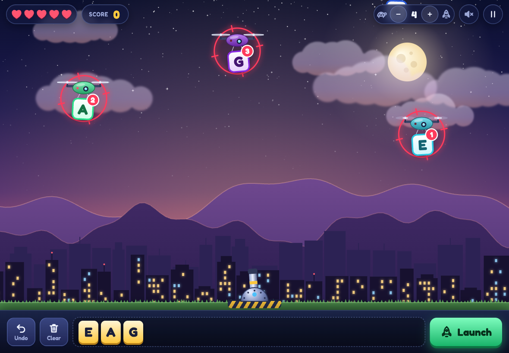

# Spell Defense

A bilingual (English/Hebrew) spelling tower-defence browser game for early readers.



## How to Play

Drones carry letters across the screen. Tap or click drones in order to build a word — each gets a numbered target. When ready, press **Launch** to fire missiles at the marked drones, destroying them and scoring points.

- Your word must be a real word at least as long as the level minimum to score
- A correct word scores `10 × number of letters × level multiplier`
- A non-word costs one of your 5 lives
- If a marked drone reaches the ground before you launch, its letter drops out of the plan

The game never tells you which word to spell — you build it yourself.

## Levels

| Level | Minimum Letters | Multiplier |
|-------|-----------------|------------|
| Easy | 2+ | 1× |
| Medium | 4+ | 2× |
| Hard | 6+ | 3× |

## Controls

| Action | Control |
|--------|---------|
| Launch word | Enter, or tap or click the Launch button |
| Undo last letter | Backspace |
| Pause game | Escape |
| Change speed (in-game) | Use speed slider in top bar |
| Toggle sound | Tap or click the speaker icon in top bar |

## Settings

Before starting a game, choose:
- **Language**: English or עברית (Hebrew)
- **Level**: Easy, Medium, or Hard
- **Speed**: 1–10 (drone speed, adjustable in-game)
- **Sound**: On/Off (toggleable in-game)

## Play Online

https://wilfoa.github.io/ex-spell-otion/

Or open `index.html` locally in your browser — no installation needed.

## Development

### Test

```bash
npm test
```

Runs tests with Node.js's native test runner.

### Regenerate Word Lists

```bash
npm run words
```

Rebuilds word list files in `words/` from FrequencyWords.

## Credits

Word lists are [FrequencyWords](https://github.com/hermitdave/FrequencyWords) by Hermit Dave, used under [CC-BY-SA 4.0](https://creativecommons.org/licenses/by-sa/4.0/).
